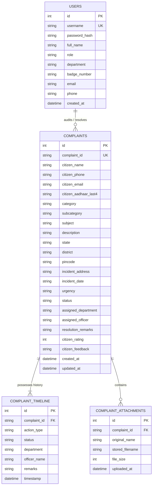
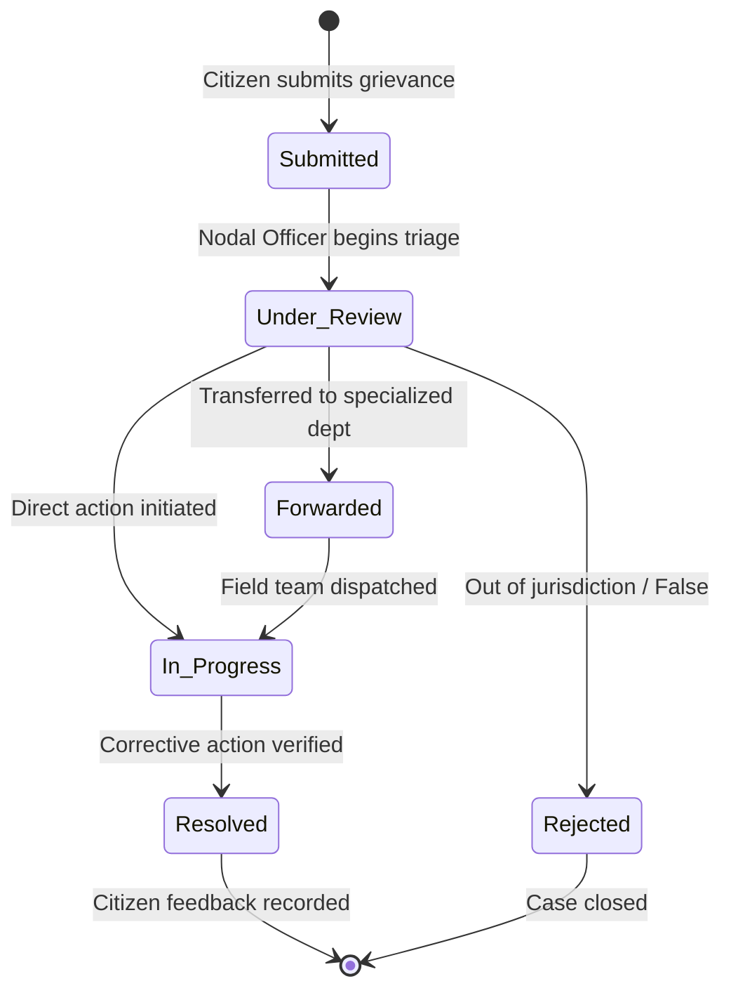

# System Architecture & Technical Specification
## All-in-One Government Complaint Management System

---

## 1. System Overview & Architecture Design

The All-in-One Government Complaint Management System implements a multi-tier modular architecture designed for high availability, low latency, and zero deployment friction.

```
┌────────────────────────────────────────────────────────────────────────┐
│                        PRESENTATION TIER (UI)                          │
│   ┌──────────────┐   ┌──────────────┐   ┌─────────────┐  ┌───────────┐ │
│   │ Citizen Home │   │ Registration │   │ Track / SLA │  │ Officer   │ │
│   │ (index.html) │   │ (register)   │   │ (track.html)│  │ (admin)   │ │
│   └───────┬──────┘   └──────┬───────┘   └──────┬──────┘  └─────┬─────┘ │
│           │                 │                  │               │       │
│           └─────────────────┼──────────────────┼───────────────┘       │
│                             ▼                                          │
│           HTML5 / CSS3 / Vanilla ES6+ Fetch API Client                 │
└─────────────────────────────┬──────────────────────────────────────────┘
                              │ HTTP / RESTful JSON
                              ▼
┌────────────────────────────────────────────────────────────────────────┐
│                       APPLICATION LOGIC TIER                           │
│   ┌────────────────────────────────────────────────────────────────┐   │
│   │ Multi-Threaded HTTP Server (app.py) / Optional Flask           │   │
│   └───────────────────────┬────────────────────────────────────────┘   │
│                           │                                            │
│   ┌───────────────┬───────┴───────┬───────────────┬────────────────┐   │
│   │ Triage Router │ Auth / Token  │ File Evidence │ Status Machine │   │
│   │ & Validation  │ Engine        │ Handler       │ & Audit Logger │   │
│   └───────┬───────┴───────┬───────┴───────┬───────┴────────┬───────┘   │
└───────────┼───────────────┼───────────────┼────────────────┼───────────┘
            │               │               │                │
            ▼               ▼               ▼                ▼
┌────────────────────────────────────────────────────────────────────────┐
│                          DATA STORAGE TIER                             │
│   ┌───────────────────────────────┐   ┌────────────────────────────┐   │
│   │ SQLite3 Database Engine       │   │ File Evidence Storage      │   │
│   │ (complaints.db)               │   │ (/uploads/ directory)      │   │
│   │ Users • Complaints • Timeline │   │ Documents • Photos • PDFs  │   │
│   └───────────────────────────────┘   └────────────────────────────┘   │
└────────────────────────────────────────────────────────────────────────┘
```

---

## 2. Entity-Relationship (ER) Model



---

## 3. Data Flow Diagram (DFD Level 1)

```
[Citizen] ─────── Lodges Complaint ─────────> (1.0 Registration Desk)
                                                        │
                                                        ├── Store Record & Attachments ──> [Complaints DB]
                                                        │
[Citizen] <────── Returns Complaint ID ─────────────────┤
                                                        │
                                                        ▼
[Nodal Officer] <── Assigns & Reviews ────── (2.0 Triage & Forwarding)
       │                                                │
       │                                                ├── Write Audit Log ──> [Timeline DB]
       ▼                                                │
(3.0 Field Redressal Action) ───────────────────────────┘
       │
       ├── Updates Status (In Progress / Resolved)
       ▼
(4.0 Citizen Tracking & Feedback) <────── Query Status & Timeline ────── [Citizen]
       │
       └── Submits 5-Star Rating & Review ──> [Complaints DB]
```

---

## 4. Complaint Lifecycle State Transition Machine



---

## 5. Security & Privacy Safeguards

1. **Authentication**:
   - SHA-256 cryptographic password hashing with unique salt string.
   - Bearer session token verification for privileged officer mutations.
2. **Citizen Privacy**:
   - Identity numbers (Aadhaar) are strictly masked to the last 4 digits only.
   - Public transparency pages anonymize citizen names to uphold privacy while keeping grievance status public.
3. **Evidence File Safety**:
   - Filenames are sanitized and prepended with UTC timestamp tokens to prevent file collisions.
   - Strict extension whitelisting (`.png`, `.jpg`, `.jpeg`, `.pdf`, `.docx`, `.txt`) and 10 MB payload limits prevent directory traversal or remote script execution.
4. **Data Integrity**:
   - Foreign key cascading ensures timeline and attachment records remain synchronized with root complaint entries.
   - Database operations use atomic commits with automatic rollback on error.
